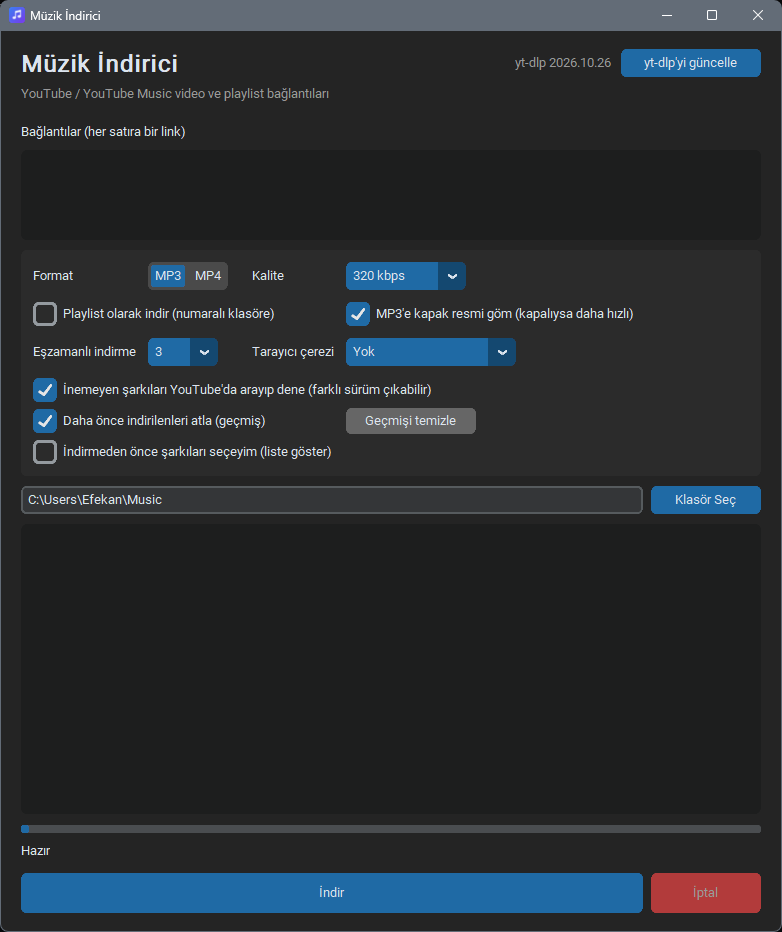

# Music Video Downloader


=======

A Windows desktop app for downloading videos and music from YouTube and YouTube Music.
Download as MP3 or MP4, single videos or whole playlists in bulk.



> **Disclaimer:** This software is intended only for downloading your own content,
> royalty-free / Creative Commons licensed content, or content you otherwise have the right to download.
> YouTube's Terms of Service and copyright law vary by country, and you alone are responsible for how
> you use this software. This project is not affiliated with YouTube, Google or yt-dlp.

## Features
- Download as MP3 (128 / 192 / 320 kbps) or MP4 (360p - 1080p), with embedded cover art and tags
- Playlist support (saved into a numbered folder) and multiple links at once (one link per line)
- Several simultaneous downloads (1-4)
- Pick which tracks to download from a playlist before starting
- Download history: never downloads the same track twice
- Fallback methods for tracks that fail (music.youtube.com, a different client, YouTube search)
- Browser cookie or `cookies.txt` support for videos that require signing in
- In-app yt-dlp updates, so YouTube changes don't require a new build
- Detailed `hata_kaydi.txt` (error log) written to the download folder when something fails

## Download (ready-made exe)
1. Go to the [latest release](https://github.com/Phraysix/Music-Video-Downloader/releases/latest) and download `MuzikIndirici.exe`.
2. Double-click it. No installation needed; ffmpeg and Deno are bundled inside the exe.
3. If Windows SmartScreen shows an "unknown publisher" warning, click "More info" and then "Run anyway".
   This is expected because the exe is not code-signed.

Requires 64-bit Windows 10 or 11.

## Interface language
The interface is currently in Turkish. Here is what the main labels mean:

| Turkish label | English meaning |
|---|---|
| Bağlantılar | Links (one per line) |
| Format / Kalite | Format / Quality |
| Playlist olarak indir | Download as playlist |
| MP3'e kapak resmi göm | Embed cover art in MP3 |
| Eşzamanlı indirme | Concurrent downloads |
| Tarayıcı çerezi | Browser cookies |
| İnemeyen şarkıları YouTube'da arayıp dene | Search YouTube for tracks that fail |
| Daha önce indirilenleri atla | Skip previously downloaded tracks |
| Geçmişi temizle | Clear history |
| İndirmeden önce şarkıları seçeyim | Let me pick tracks before downloading |
| yt-dlp'yi güncelle | Update yt-dlp |
| Klasör Seç | Choose folder |
| İndir / İptal | Download / Cancel |

## Run from source
Requires Python 3.10 or newer.
```
git clone https://github.com/Phraysix/Music-Video-Downloader.git
cd Music-Video-Downloader
pip install -U -r requirements.txt
python app.py
```
You also need Deno (PowerShell): `irm https://deno.land/install.ps1 | iex`
and ffmpeg + ffprobe (see "Build the exe" below, or add them to your PATH).

## Build the exe
The repository does not contain ffmpeg or Deno (the files are too large). Add them yourself:

1. Create a folder named `bin` in the project folder.
2. Put these files inside it:
   - `ffmpeg.exe` and `ffprobe.exe`: https://www.gyan.dev/ffmpeg/builds/ → *ffmpeg-release-essentials.zip* → the `bin` folder inside it
   - `deno.exe`: https://github.com/denoland/deno/releases → *deno-x86_64-pc-windows-msvc.zip*
3. Double-click `build.bat`. The result is `dist\MuzikIndirici.exe`.

## Troubleshooting
- **Some tracks say "Video unavailable":** The playlist entry may have been removed from YouTube. Keep
  "Search YouTube for tracks that fail" enabled, the app will search for a replacement (it may be a
  different version, such as a live recording; the log shows which video it found).
- **Sign-in / age-restriction errors:** Choose the browser you are signed in to YouTube with under
  "Browser cookies" (Firefox works most reliably). Chromium-based browsers (Chrome, Edge, Opera GX)
  lock their cookie database while running; close the browser completely or choose the
  **cookies.txt** option instead. `cookies.txt` contains your account's login data:
  never share it and never upload it to GitHub.
- **Downloads suddenly fail:** YouTube changes often. Click "Update yt-dlp" (top right) and restart the app.
- **Speed:** Increase "Concurrent downloads" (2-4). Turning off cover-art embedding also helps.
- The exe is about 250-300 MB because ffmpeg and Deno are bundled, and the first launch takes a few seconds.

## Reporting problems
Found a bug? [Open an issue](https://github.com/Phraysix/Music-Video-Downloader/issues) and include the
relevant part of `hata_kaydi.txt` from your download folder. **Check it before posting:** the log can contain
file paths with your Windows username, so remove anything personal first.

## License
MIT. For bundled third-party components, see [THIRD_PARTY_NOTICES.md](THIRD_PARTY_NOTICES.md).
